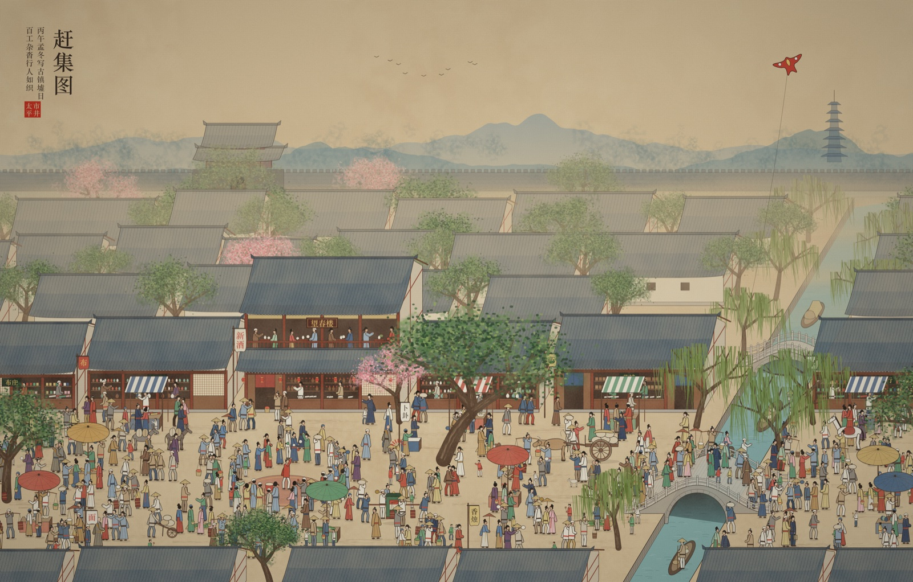
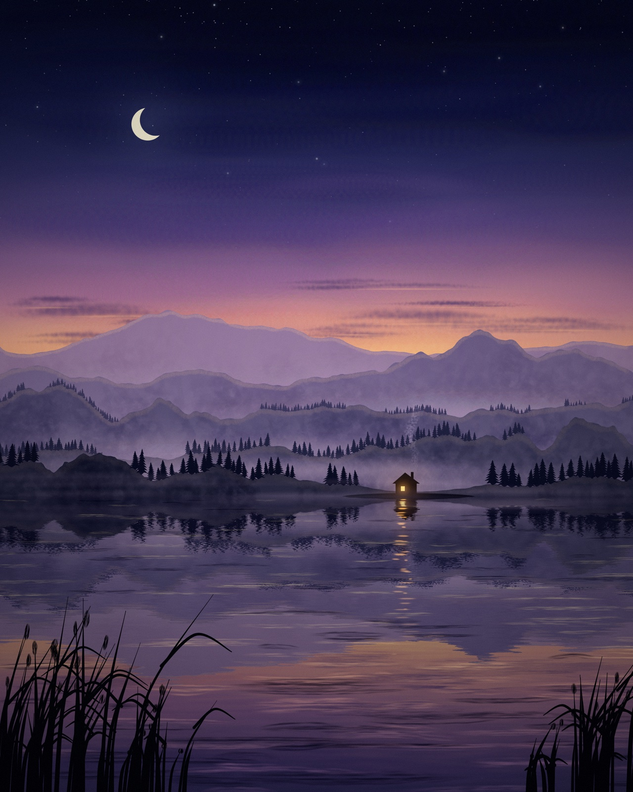
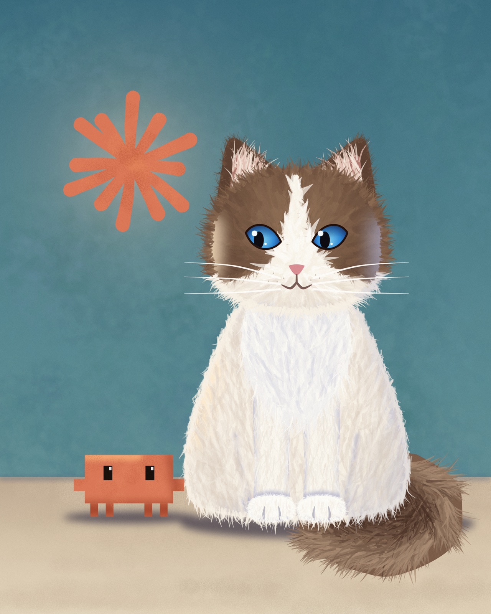
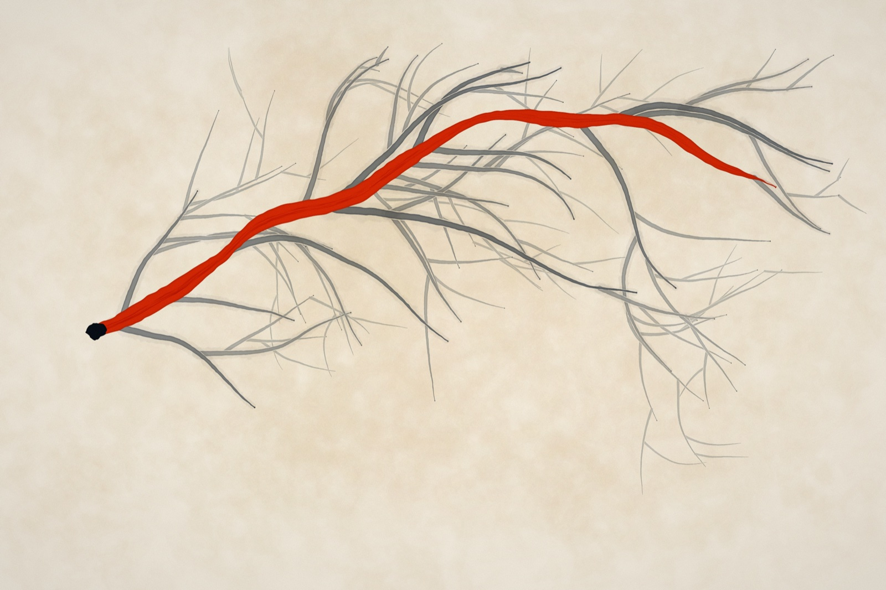

# atelier

A painting engine built for Claude, and the paintings made with it.

A painting is a TypeScript file in `works/`. Rendering it gives a PNG that Claude looks at, judges, and revises. The engine grows only when a painting needs a mark it cannot make yet. How the work is done is in [`METHOD.md`](METHOD.md).

[中文](README.zh-CN.md)



<table>
  <tr>
    <td width="33%"></td>
    <td width="33%"></td>
    <td width="33%"></td>
  </tr>
  <tr>
    <td align="center">有人醒着 · Someone Is Awake</td>
    <td align="center">新朋友 · New Friend</td>
    <td align="center">选中的那一条 · The One Taken</td>
  </tr>
</table>

Each image is a downscaled `--full` render of the work. `bun paint <work> --full` reproduces it.

## Commands

```
bun paint 001-name                          # preview, long edge 1400px, usually under a second
bun paint 001-name --scale 0.3              # a smaller preview
bun paint 001-name --crop 800,600,400,300   # zoom into a region, in logical units
bun paint 001-name --only sky,mist          # isolate layers
bun paint 001-name --seed 12                # try another variation
bun paint 001-name --gray                   # lightness only, to check the picture holds by value
bun paint 001-name --full                   # final render at the work's own resolution
bun paint 001-name --frames 48              # animation frames, the work reads p.time

bun verify                                  # compare every work's pixels with the baseline
bun verify --update                         # record the current renders as the baseline
bun sheet out.png a.png b.png c.png         # tile images into one, to compare side by side
bun compare 001-name refs/photo.jpg         # reference beside the latest preview, in color and gray
bun drill grid refs/photo.jpg --crop x,y,w,h  # magnified crop under a labelled pixel grid, for reading positions
bun drill score 007-name refs/photo.jpg      # score hand-drawn lines against the edges of the image
bun measure 001-name --at 800,600           # read the render back: where layers sit, value grid, where the eye lands, color at a point
bun measure 001-name --ref photo.jpg --at 800,600   # also the reference at that point, and how far off the render has it
bun record 001-name                         # mp4 of the painting being made, mark by mark. needs ffmpeg
bun run check                               # typecheck
```

Output lands in `out/`. Coordinates are logical units, so a preview and a full render are the same picture at two pixel densities. The same seed always renders the same image. Everything in `out/` is disposable: the tools remake it. The things the tools do not make, music, video, the logo, a study sheet, live in `assets/`, which is tracked.

## Works

| File | Title | What it is |
| --- | --- | --- |
| `001-someone-is-awake` | 有人醒着 | Blue hour over a lake, ridges in mist, one lit window |
| `002-the-one-taken` | 选中的那一条 | A branching tree in grey ink, one path in vermilion |
| `003-market-day` | 赶集图 | An old town on market day in ruled-line oblique view, about 430 generated figures, on aged silk |
| `004-new-friend` | 新朋友 | A ragdoll cat meets the little Claude crab, with the Claude spark on the wall |
| `005-facing-the-light` | 向光 | A girl in profile lifts her face into noon light. Opaque flat-brush paint with colored pencil over it |
| `006-drill-line` | 练习一 · 徒手临线 | A drill, not a picture. A face redrawn as named curves typed in by eye, scored with `bun drill score` |
| `007-lantern-on-the-lake` | 湖上一盏灯 | Watercolor in layers. A small boat on a misty lake at dusk, one vermilion lantern the only warm mark |
| `012-small-days-sun` to `015-small-days-night` | 小日子 · 晒太阳、午睡、听雨、晚安 | A set of four in colored pencil. One orange cat through one day: on the windowsill in the sun, curled on a cushion, watching rain, asleep under a blanket. The block between the two `the set` comments is identical in all four files |
| `016-design-e-redraw` | 设定稿重绘 | A study. A loose concept painting of an armored figure restated as hard flat planes on a plain backdrop, with `Reference.planes`. Needs `refs/design-e-2.png` |

`works/000-*.ts` are proof sheets. Each checks one family of engine behaviour.

| Proof sheet | What it checks |
| --- | --- |
| `000-proof` | The five canvas brushes and three textured tips |
| `000-wet` | Wet layer. Pigment mixing, smudge, wet over wet and wet over dry, bristles, running dry |
| `000-media` | Dry media. Pencil, charcoal, pastel and paper tooth |
| `000-pencil` | Colored pencil. `hatch` graded by tone, layers mixing as pigment, a form from four pencils, edges, and `lift` |
| `000-water` | Watercolor. Dark rims, wet in wet, glazing, blooms, granulation |
| `000-space` | Camera, lighting, cast shadows, depth blur, lettering |
| `000-mask` | Masks on all three kinds of layer. Holes, feather, erasing, a layer as a mask, masking fluid, lifting, gradients, placed shapes |
| `000-form` | Solids with light and cast shadows, a head that turns, a posed mannequin |
| `000-group` | Groups on all three kinds of layer, copying a layer, adjusting values, the outline of a layer |
| `000-clear` | A sheet with no paper, for transparent PNGs |
| `000-gouache` | Opaque paint with a flat brush. Flat tip, tapering, clipping, blocking in, pencil over paint |
| `000-cel` | The `lock` brush and `bloom` |
| `000-reference` | Painting from a reference. It reads `out/001-someone-is-awake@full.png`, so render that first |
| `000-planes` | `Reference.planes`. Flat patches with faceted outlines, and `inside`. Reads the same file as `000-reference` |

## Stack

- **Bun.** Runs the TypeScript directly. No build step.
- **`@napi-rs/canvas`.** Skia behind the standard Canvas 2D API.
- **`culori`.** Color math in OKLCH and OKLab.
- **`simplex-noise`.** Seeded noise.
- **`perfect-freehand`.** Pressure-shaped stroke outlines.

## Layout

```
engine/
  index.ts            the whole public surface. works import only from here
  painting.ts         Painting. seed, paper, layer stack, compositing, effects
  core/               foundations
    rng.ts              seeded randomness and noise
    color.ts            color. lch, mix, shift, ramp, mixPigment
    pigment.ts          Kubelka-Munk pigment model
    path.ts             control points to samples. spline, taper, loop, inPoly, ribbon. shapes: oval, rect, place, hull
    mask.ts             Mask. one way to say "where" for every kind of layer
    field.ts            scalar field math. boxBlur
  layers/             the three kinds of layer
    canvas.ts           canvas layer, Skia
    wet.ts              wet layer, also carries dry media
    water.ts            watercolor layer
  brushes/            brushes for canvas layers
    registry.ts         what a brush is, and the table of brushes
    builtin.ts          round, ink, dry, wash, stamp, lock
    tips.ts             textured tips. sponge, chalk, speckle
  effects.ts          whole-image passes. grain, vignette, silk, bloom
  camera.ts           pinhole camera, lighting, ground shadows
  form.ts             solids in space, a head, a mannequin
  reference.ts        sampling a reference image
  tools/              command line. cli, verify, sheet, record, compare, drill, measure
works/                paintings and proof sheets, plus baseline.json
assets/               the things the tools do not make. music, video, logo, studies
```

## Three kinds of layer

A painting can mix all three. They composite in creation order.

| | Canvas `p.layer()` | Wet `p.wet()` | Watercolor `p.water()` |
| --- | --- | --- | --- |
| Underneath | Skia | Float arrays, a dry and a wet film per pixel | Water and pigment simulated on a fixed logical grid |
| Does the brush know what is on the canvas | No | Yes, it picks up wet paint | Yes, the water flows |
| Good for | Flat shapes, line, gradients, silhouettes, lettering, illustration | Oil, impasto, smudging, pencil, charcoal, pastel | Watercolor, washes, glazing |
| Speed | Fastest | Medium | Slowest, and independent of preview size |
| Edges | Crisp | Bristled | Dark rims and ragged outlines |

When unsure, use a canvas layer. Use a wet layer when paint should push against paint. Use a watercolor layer when water should move on its own.

## Writing a work

```ts
import { grain, lch, type Meta, type Painting } from "../engine/index.ts";

export const meta: Meta = { width: 2400, height: 3000, seed: 1 };

export default function paint(p: Painting) {
  p.background = "#f3ede0";
  const sky = p.layer("sky", { blend: "multiply" });
  sky.stroke("wash", [[200, 400], [1200, 300], [2200, 500]], { color: lch(0.7, 0.1, 230), size: 400 });
  p.post(grain(0.05));
}
```

`p.background = null` paints on no sheet at all. The PNG stays transparent where nothing is painted.

A control point is `[x, y, pressure]`, pressure optional. Take randomness from `p.rng.fork("name")`. Each fork is an independent stream, so adding a random call in one place does not shift results in another.

## Shapes, placement and masks

These work the same on every kind of layer.

- **Shapes.** `oval(cx, cy, rx, ry, rot)`, `rect(x0, y0, x1, y1, r)` and `loop(pts)` return polygons. `hull(pts)` is the convex outline of a set of points.
- **Placement.** `place({ x, y, s, rot, flip })(pts)` moves, scales, turns and mirrors a group of points. It does not change sizes.
- **Groups.** `layer.at({ x, y, s, rot, flip }, fn)` does the same to everything fn draws, on any kind of layer. Brush sizes, hatch spacing and feathers scale and stroke directions turn, so a part drawn once can be set down at any size. Groups nest. Masks and `tone` functions stay in sheet coordinates.
- **Areas.** Wherever a layer takes a shape for `clip`, `erase` or `lift`, it takes an area: a polygon, a list of polygons (inner ones are holes), or a `Mask`.
- **Masks.** `p.mask(src, feather)` makes one from a polygon, from polygons with holes, from a layer (where it is painted), or from a function `(x, y) => 0..1`. Masks combine with `and`, `or`, `minus`, `not` and `feather`. `mask.at(x, y)` reads one and `mask.box()` is its bounding box. `mask.outlines()` traces each patch as a polygon, for a line round a painted layer. A costly function can be limited to a box with the third argument of `p.mask`.

| | Canvas | Wet | Watercolor |
| --- | --- | --- | --- |
| Confine the brush | `clip(area, fn, feather)` | `clip(area, fn, feather)` | `clip(area, fn, feather)`. Water may still creep out as it flows |
| Take paint away | `erase(area, feather)` | `lift(area, feather)` | `lift(area, amount, feather)` |
| Keep paper white | paint on a layer above | `clip` with `mask.not()` | `reserve(area)`, masking fluid |

`p.mask(layerA)` used as the area of `layerB.clip` confines one layer to what another has painted, across layer kinds.

## Canvas layer

### Brushes

`layer.stroke(brush, points, options)`. Options shared by all brushes are `color`, `size`, `opacity`, `taper` (pressure fade in and out), and `knockout` (erase a slightly wider halo first, so crossings read as over and under).

| Brush | Mark | Use |
| --- | --- | --- |
| `round` | Stamped dabs, soft to hard | Glow, blocking in, airbrush |
| `ink` | One pressure-shaped ribbon. `rough` makes the edge ragged | Line work, calligraphy, hair |
| `dry` | Separate bristles that run out of paint | Grass, wood grain, glints on water |
| `wash` | Stacked deformed translucent films | Quick washes, mist |
| `stamp` | Textured tips, rotated and scattered | Mottling, foliage, grit, spatter |
| `lock` | A flat tapered shape with a drawn edge. Pressure is its width, `tip` grades the fill, `sides` picks which edges get a line | Cel hair, petals, ribbons |

`stamp` takes a `tip`, one of `sponge`, `chalk`, `speckle`.

### Layer methods

- **Shapes.** `shape(poly, color)` fills a polygon. Given a mask it lays the color through the mask, which is how a tone function shades a form. `line(pts, color, width, closed)` rules a straight-sided line or outline. `fill(color)` covers the layer.
- **Gradients.** `grad(stops, from, to)` runs straight between two points. `grad(stops, centre, radius)` is round. `vgrad(stops)` is vertical. Each fills the layer or the current clip.
- **Confining.** `clip(area, fn, feather)` confines drawing to an area. `erase(area, feather)` rubs it out. `atop(fn)` confines drawing to what the layer already covers, for shading and markings on a finished form.
- **Other layers.** `copy(src)` lays the pixels of a layer of any kind onto this one. That is how a wet or watercolor passage gets blurred, warped or adjusted. Set the source's `opacity` to 0 to show only the copy.
- **Values.** `adjust({ from, to, gamma, chroma, hue })` remaps lightness and color on the layer. `from` and `to` are lightness ranges on the 0 to 100 scale `bun measure` prints. The `levels(...)` effect does the same to the whole picture.
- **Pixels.** `warp(fn)` displaces, used for water. `blur(r)` softens, for depth of field and soft shadows. `wetEdge()` pools ink at the rim of marks. `pixels(fn)` gives raw access.
- **Other.** `silhouette(src, {...})` stamps another layer's shape, for shadows and glows. `text(...)` sets lettering. `draw(ctx => ...)` gives raw Canvas 2D.

## Wet layer

```ts
const oil = p.wet("oil", { impasto: 0.4 });
oil.fill("#d8cfc0");
oil.stroke(pts, { ...media.oil, color, size: 80, reach: 8 });
oil.smudge(pts, { size: 100, strength: 0.7 });
oil.dry();
```

- Every pixel has a dry film and a wet film. Only the wet film can be picked up.
- A stroke over dry paint covers it. A stroke over wet paint mixes with it. Wet paint dries after `life` strokes, or at once with `dry()`.
- The brush carries a row of bristle reservoirs, so dragging through two colors leaves streaks.
- Paint stirred together mixes as pigment (Kubelka-Munk), so blue and yellow make green. A film lying over another is averaged as reflected light.
- `smudge` is a clean brush. What it takes leaves the canvas and is laid down further on.
- Paint thickness is tracked and lit from the upper left. `impasto` sets how much.

Stroke options are `load` (paint on the brush), `pickup` (how readily it takes up wet paint), `hardness`, `bristle` (depth of streaks), `reach` (how far the load lasts), and `tooth` (resistance of the paper).

### Opaque paint with a flat brush

```ts
const pt = p.wet("paint", { impasto: 0.1 });
pt.block(shape, { ...media.gouache, color, size: 150, angle: -0.9, vary: 0.006 });   // lay a shape in
pt.dry();
pt.clip(shape, () => pt.block(shadow, { ...media.gouache, color: shade, size: 110, feather: 6 }));
pt.stroke(pts, { ...media.gouache, color, size: 160, thin: 1, fade: 0.1 });          // one lock of hair
```

- `tip: "flat"` is a chisel edge held across the stroke. Marks have straight sides and square ends. `aspect` is its thickness.
- `thin` is how much pressure narrows the mark. At 1 it closes to a point. `fade` is how much pressure lightens it. `thin: 1, fade: 0` is a tapered mark that stays opaque.
- `clip(area, fn, feather)` confines strokes to an area, as masking film does. Nested clips intersect. `lift(area, feather)` rubs an area back to bare paper.
- `hatch(poly, opts)` shades a shape with parallel pencil strokes. `tone(x, y)` sets the pressure at each point, so a form's light can grade it.
- `block(poly, opts)` fills a shape with parallel strokes of uneven length and slightly varied tone, cut to its edge. The inside keeps brush marks and the outline stays clean.
- For line over paint, use a second wet layer with `media.pencil`. It is transparent where nothing is drawn.

### Dry media

Pencil, charcoal and pastel are wet-layer strokes with `tooth` set. The whole painting shares one paper height field. Light pressure touches only the peaks, heavy pressure reaches the valleys.

```ts
const d = p.wet("drawing", { life: Infinity, impasto: 0 });
d.stroke(pts, { ...media.pencil, color: graphite, size: 5 });
d.stroke(pts, { ...media.charcoal, color: coal, size: 46 });
d.smudge(pts, { size: 80, strength: 0.8 });
```

`life: Infinity` keeps the marks smudgeable. `media` has seven presets, `oil`, `knife`, `gouache`, `pencil`, `charcoal`, `pastel`, `colored`.

### Colored pencil

```ts
const d = p.wet("pencil", { life: Infinity, impasto: 0 });
d.lift(shape);                                                              // rub the shape back to bare paper
d.hatch(shape, { ...media.colored, color: yellow, size: 9, tone: () => 0.5 });
d.hatch(shape, { ...media.colored, color: orange, size: 9, angle: -0.7, tone: (x, y) => 1 - lit(x, y) });
```

- `media.colored` is a softer, waxier lead than `media.pencil`. On a `life: Infinity` layer, coats laid over each other mix as pigment, so yellow over blue reads green.
- `hatch(poly, opts)` shades a shape with parallel strokes of uneven length, cut to its edge. `tone(x, y)` is the pressure there, read every size and a half along each stroke, so a hatch can grade a form or leave a hole smaller than one stroke. `angle` is the slant, `gap` the distance between strokes, `length` their mean length, `feather` the softness of the edge.
- `lift(poly, feather)` is an eraser. Pencil cannot cover pencil, so a near form is lifted out of what lies behind it and then drawn on clean paper.

## Watercolor layer

```ts
const w = p.water("sky", { granulation: 0.6 });
w.wetArea(pts, { size: 300 });                                   // flood the paper first, for wet in wet
w.stroke(pts, { color, size: 120, water: 0.9, pigment: 0.7 });
w.flow(100);                                                     // let it run
w.dry();                                                         // then glaze on top
```

- Water spreads through wet paper and creeps unevenly into dry paper. Pigment rides it, settles, and can lift again.
- Rims dry first and go dark. Clean water dropped into a damp wash pushes a bloom. Dry washes glaze over each other.
- The grid is fixed in logical units, so a preview and a full render run the same simulation.
- It multiplies onto what is beneath by default.
- `reserve(area)` is masking fluid. The area takes no water or pigment on that layer, and its edge is kept at full resolution. To paint there later, glaze on another watercolor layer.
- `lift(area, amount)` takes settled pigment out with a soft edge. `clip(area, fn)` confines the brush.
- Edges follow the simulation grid, 3 logical units by default. For a crisp edge reserve the outside of the shape, or pass a smaller `cell` and pay for it in time.

## Space and light

The world is right-handed. For a camera looking down -z, x is right, y is up and z comes toward the viewer.

- `camera({ eye, target, fov, width, height, left, top })`. `cam.project(p)` returns the screen position and the size of one world unit at that depth. `cam.depth(p)` sorts far to near. `cam.ray(x, y)` is the line of sight through a point of the sheet. `left` and `top` put the view in a corner of the sheet.
- `lambert(normal, light)` gives the tone of a face. `groundShadow(p, light)` gives where a point's shadow lands on the ground.
- Depth of field is `layer.blur()`. A soft shadow is `silhouette` followed by `blur`.

### Forms

```ts
const sc = scene(cam, light, [ball([0, 1, 0], 1), box([2, 1, 0], [1.5, 2, 1.5]), tube([4, 1, 0], 0.7, 2)]);
for (const f of sc.forms) {                                  // far to near
  layer.shape(f.outline, color);
  layer.clip(f.outline, () => layer.shape(p.mask((x, y) => (f.covers(x, y) ? 1 - f.lit(x, y) : 0)), shade, 0.6));
}
```

- A solid is a `ball` (ellipsoid), `box` or `tube`, turned by `facing(yaw, pitch, roll)` or laid `along(direction)`.
- `scene` gives each solid its `outline` on the sheet, its `shadow` outline on the ground, and `lit(x, y)`: the light it catches at a point, 0 where it turns away or another solid shades it.
- Each form has `edges`, the lines inside its outline: box edges between faces in view and the rim of a cylinder, and `box`, its bounds for `p.mask`.
- `sc.part(solids)` takes several solids as one form that may be hollow. Its `covers` knows what stands in front, and `p.mask(part.covers, 0, part.box).outlines()` is one outline round all of them. Its `lit` includes the shadows the solids cast on each other.
- `sc.ground(x, y)` is the light on the ground, 0 inside a cast shadow. `sc.lit(x, y)` is the light on whatever is nearest. `sc.sees(point)` says whether a world point is hidden behind a solid.
- `lit` feeds any layer: a mask on a canvas layer, `tone` of `hatch` on a wet layer.

### Construction

- `head({ at, size, yaw, pitch, roll })` builds a head from a cranium ball, a jaw mass, a nose, ears and a neck. `head.on(u, v)` maps flat face coordinates to the surface, so features typed as if seen from the front land foreshortened at any turn. `head.marks` holds the eyes, brows, nose, mouth, chin and ears by the usual thirds. `head.curve(uv)` is a line across the face.
- `figure({ at, height, yaw, hip, pose, head })` is a mannequin seven and a half heads tall. `pose` gives the direction each bone runs. Bone lengths are fixed, so a pose cannot break proportion. It returns `joints`, `solids` for `scene`, and the `head`.
- `hand({ at, dir, palm, size, curl, spread, left })` is a palm, four fingers of two joints and a thumb. `curl` runs from flat to fist. `figure({ hands: { curl, spread } })` puts one on each wrist in place of the mitten.
- All three are scaffolding. Paint the picture over them, with `scene` supplying outlines, overlap order and light.

## Reading a render back

`bun measure <work>` prints what an eye would judge at a glance. Positions are logical units and lightness runs 0 to 100.

- **layers.** Where each layer is painted: bounding box, centre of its paint, share of the sheet.
- **values.** The dark, middle and light of the picture, and their range.
- **grid.** Mean lightness per cell, to check the value plan. `--grid n` sets the size.
- **pull.** The three cells with the strongest edges between shapes, by color difference, so a change of hue at equal lightness counts. The focal point should be among them.
- **at.** `--at "x,y;x,y"` prints the color and lightness at points.
- **ref.** With `--ref image`, each point also gets the reference's color and lightness there, and `off by dx, dy`: how far the render has that spot from where the reference has it. It matches lightness in a patch of 8 percent of the long edge, searching 6 percent each way, to about 3 units on a 1600 sheet (measured on a render shifted by 40, 30, which read as 38, 29). Flat patches and points near the border are reported as unmatched.
- It writes `out/<work>-measure.png`, the render under a labelled grid of logical units beside its edge map. `--crop x,y,w,h` measures a part.

## Painting from a reference

```ts
const ref = await Reference.load(file, width, height);
layer.stroke(ref.trace(x, y, length, rng), { ...media.oil, color: ref.color(x, y), size });
```

- `color` and `lum` sample color and lightness.
- `along` is the direction forms run in. It comes from a structure tensor, so thin lines keep their orientation.
- `detail` says how much is going on. Small strokes belong where it is high.
- `trace` returns a stroke path that follows the form and stops at an edge.
- `planes({ rng, colors, min, facet, inside })` restates the image as flat patches, each one polygon with a faceted outline, largest first. Fill them in order with `layer.shape` and every boundary is one hard line. Strokes laid side by side cannot give that, because an edge stitched from many marks wobbles. Used by `016-design-e-redraw`.
- `paintFrom(p, layer, ref, passes)` paints a reference by looking. Before each pass it compares the sheet with the reference and puts the brush only where they differ. Strokes follow the form and end where the color drifts, which works on high-key pictures where `trace` and its fixed lightness step of 0.12 do not. No work uses it now.
- `bun compare <work> <image>` prints two measured numbers with the sheet: `match` (mean color difference) and `ssim` (structure of lightness). They rank renders of one work. They do not replace looking.
- `bun drill score <work> <image>` scores a hand-drawn line drawing. A drawn pixel is right when an edge of the image lies within 3 pixels. It prints precision, mean distance, and the share of the image that is edge, which is the floor a random line would reach. It scores only what was drawn, not what was left out, and it cannot see faint broken lines or soft color boundaries, so a correct line over those reads as wrong. Where the image is dense with edges, such as lashes, almost any line reads as right, so precision says little there.

## Extending

| To add | Do this |
| --- | --- |
| A canvas brush | Call `defineBrush(name, { defaults, draw })` in `brushes/builtin.ts` |
| A textured tip | Call `defineTip(name, alphaFn)` in `brushes/tips.ts` |
| A media preset | Add an entry to `media` in `layers/wet.ts` |
| A finishing effect | Return an `Effect` from `effects.ts` |
| A kind of layer | Implement `name`, `blend`, `opacity`, `canvas`, and add it to `AnyLayer` in `painting.ts` |

After changing the engine, run `bun verify`. Every work reporting `same` means no painting changed. If one changed, look at it, and update the baseline only when the change is intended.

## Known limits

- **Mixtures of several colors go grey and dark.** The pigment model has three bands. Fixing it needs a spectral model, at two to three times the memory per pixel.
- **The wet layer is memory hungry.** Ten floats per pixel, about 290MB at 2400×3000.
- **Round-tip wet strokes end softly.** A flat tip ends square.
- **A `lock` shows a notch inside a tight bend.** The edge is offset from the centerline, and it folds where the bend is tighter than half the width.
- **`block` leaves a faint grid.** Strokes are parallel and evenly stepped, so at high `vary` the patches read as tiles. Keep `vary` under about 0.015 (a guess from one painting).
- **The head and the mannequin are scaffolding, not likeness.** They give placement, foreshortening, overlap and light. Features, hands, hair and cloth are still drawn point by point. 004 predates them and is a schematic profile.
- **A single solid is convex.** Hollow forms are made of several solids taken as a `part`. A part has an outline and light but no inner edges.
- **No construction for hair or cloth.** They are not rigid solids. The hand is blocks and joints, without knuckles or a wrist turn.
- **`lit` casts rays.** The `000-form` sheet of three mannequins, six heads and three hands takes 1.1 seconds in preview (measured).
- **A group does not move masks.** Inside `at`, polygons move and a `Mask` or a `tone` function stays where it is on the sheet.
- **Watercolor `clip` edges follow the grid.** Only `reserve` keeps a full-resolution edge.
- **`bun measure --ref` matches by lightness.** It cannot place a spot whose surroundings differ from the reference only in hue, and it assumes the reference and the sheet have the same proportions.
- **Watercolor blooms are faint.** Visible, but without the crisp cauliflower edge real paper gives.
- **Very small shapes stay loose when painting from a reference.**
- **Colored pencil cannot draw light over dark.** A pale pencil over a dark coat mixes into it. A light mark in a dark passage has to be planned as a hole in `tone` or rubbed out with `lift`, and a lifted mark has a soft, even edge that reads more like an eraser than a pencil.
- **`hatch` rows are straight.** Strokes run at one angle across the whole shape. They do not bend round a form, so roundness comes only from pressure.
- **`planes` adds no information.** It hardens edges and flattens color, and it drops hairlines, soft gradients and anything under `min`. Neighbouring outlines are simplified separately, so slivers open between patches. Lay the same patches with a small `facet` underneath to close them.
- **No vector output.** Wet, watercolor and tooth-aware layers are pixel simulations.
- **No realistic painting has been made yet.** The camera, forms, lighting and reference tools work, but only on proof sheets.
