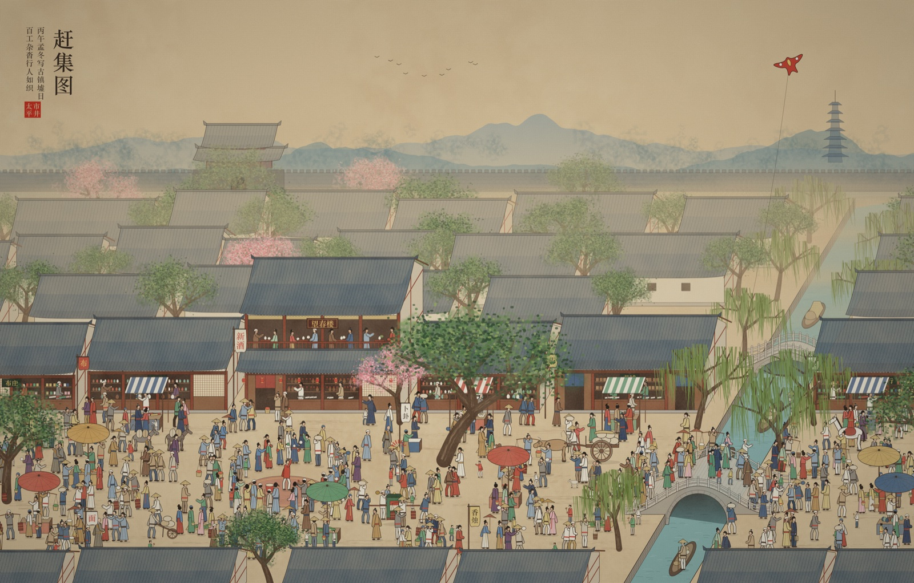
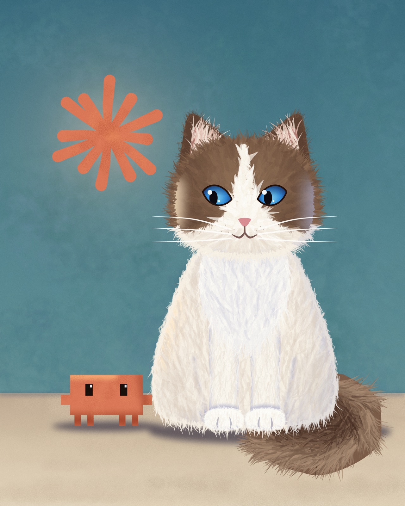
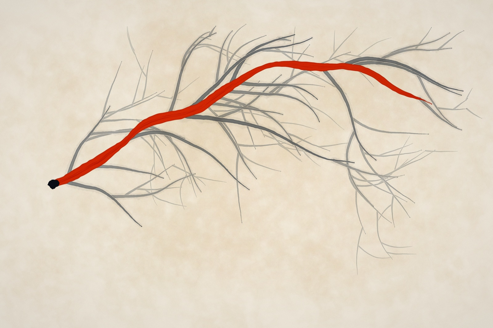

# atelier

一个给 Claude 用的绘画引擎，以及用它画的画。

一幅画是 `works/` 里的一个 TypeScript 文件。渲染它得到一张 PNG，Claude 看图、判断、修改、再渲染。引擎只在某幅画需要它做不出的笔触时才长出新能力。做事的方式记在 [`METHOD.zh-CN.md`](METHOD.zh-CN.md)。

[English](README.md)



<table>
  <tr>
    <td width="33%"></td>
    <td width="33%"></td>
    <td width="33%"></td>
  </tr>
  <tr>
    <td align="center">有人醒着</td>
    <td align="center">新朋友</td>
    <td align="center">选中的那一条</td>
  </tr>
</table>

每张图都是作品 `--full` 渲染的缩小版。用 `bun paint <作品> --full` 可以重新生成。

## 常用命令

```
bun paint 001-name                          # 预览，长边 1400px，通常不到一秒
bun paint 001-name --scale 0.3              # 更小的预览
bun paint 001-name --crop 800,600,400,300   # 放大一块区域，逻辑单位
bun paint 001-name --only sky,mist          # 只看某几层
bun paint 001-name --seed 12                # 换一个变体
bun paint 001-name --full                   # 终稿，按作品自身的分辨率
bun paint 001-name --frames 48              # 动画帧，作品读取 p.time

bun verify                                  # 所有作品的像素指纹和基线比对
bun verify --update                         # 把当前渲染记为基线
bun sheet out.png a.png b.png c.png         # 把几张图拼成一张，并排比较
bun record 001-name                         # 把作画过程逐笔录成 mp4，需要 ffmpeg
bun run check                               # 类型检查
```

输出在 `out/`。坐标是逻辑单位，预览和终稿是同一幅画的两种像素密度。同一个种子永远渲染出同一张图。

## 作品

| 文件 | 标题 | 内容 |
| --- | --- | --- |
| `001-someone-is-awake` | 有人醒着 | 蓝调时刻的湖，层叠远山，一扇亮着的窗 |
| `002-the-one-taken` | 选中的那一条 | 灰墨的分叉树，其中一条是朱红的 |
| `003-market-day` | 赶集图 | 界画式俯瞰的旧城集市，约 430 个生成的人物，绢本质感 |
| `003-new-friend` | 新朋友 | 布偶猫遇见 Claude 小螃蟹，墙上挂着 Claude 的标志 |

`works/000-*.ts` 是样张，每张检验引擎的一类能力。

| 样张 | 检验什么 |
| --- | --- |
| `000-proof` | 画布图层的五支笔和三种纹理笔尖 |
| `000-wet` | 湿图层。颜料混合、涂抹、湿压湿与湿压干、笔毛、枯笔 |
| `000-media` | 干性媒介。铅笔、炭笔、色粉和纸纹 |
| `000-water` | 水彩。水线、湿中湿、罩染、水花、颗粒沉积 |
| `000-space` | 相机、光照、投影、景深、文字 |
| `000-reference` | 照着参考图画。它读取 `out/001-someone-is-awake@full.png`，所以要先渲染那幅终稿 |

## 技术栈

- **Bun。** 直接运行 TypeScript，没有构建步骤。
- **`@napi-rs/canvas`。** Skia 内核加标准 Canvas 2D API。
- **`culori`。** OKLCH 和 OKLab 里的颜色运算。
- **`simplex-noise`。** 带种子的噪声。
- **`perfect-freehand`。** 随压感变化的笔触轮廓。

## 目录

```
engine/
  index.ts            对外的全部接口。作品只从这里导入
  painting.ts         Painting。种子、纸、图层栈、合成、后期
  core/               地基
    rng.ts              带种子的随机数和噪声
    color.ts            颜色。lch、mix、shift、ramp、mixPigment
    pigment.ts          Kubelka-Munk 颜料模型
    path.ts             控制点到采样点。spline、taper、loop、inPoly、ribbon
    field.ts            标量场运算。boxBlur
  layers/             三种图层
    canvas.ts           画布图层，Skia
    wet.ts              湿图层，也承载干性媒介
    water.ts            水彩图层
  brushes/            画布图层的笔
    registry.ts         笔的定义和注册表
    builtin.ts          round、ink、dry、wash、stamp
    tips.ts             纹理笔尖。sponge、chalk、speckle
  effects.ts          整图后期。grain、vignette、silk
  camera.ts           针孔相机、光照、地面投影
  reference.ts        参考图取样
  tools/              命令行工具。cli、verify、sheet、record
works/                作品和样张，以及 baseline.json
```

## 三种图层

一幅画可以混用三种图层，它们按创建顺序合成。

| | 画布图层 `p.layer()` | 湿图层 `p.wet()` | 水彩图层 `p.water()` |
| --- | --- | --- | --- |
| 底层 | Skia | 每像素干湿两层的浮点数组 | 固定逻辑网格上的水和颜料模拟 |
| 笔知道画布上有什么吗 | 不知道 | 知道，会带起湿颜料 | 知道，水会流动 |
| 适合 | 平涂、线条、渐变、剪影、文字、插画 | 油画、厚涂、涂抹、铅笔、炭笔、色粉 | 水彩、晕染、罩染 |
| 速度 | 最快 | 中等 | 最慢，和预览分辨率无关 |
| 边缘 | 清晰 | 带笔毛 | 带水线和毛边 |

拿不准时用画布图层。需要颜料互相推挤时用湿图层。需要水自己流时用水彩图层。

## 一幅画的写法

```ts
import { grain, lch, type Meta, type Painting } from "../engine/index.ts";

export const meta: Meta = { width: 2400, height: 3000, seed: 1 };

export default function paint(p: Painting) {
  p.background = "#f3ede0";
  const sky = p.layer("sky", { blend: "multiply" });
  sky.stroke("wash", [[200, 400], [1200, 300], [2200, 500]], { color: lch(0.7, 0.1, 230), size: 400 });
  p.post(grain(0.05));
}
```

控制点写成 `[x, y, 压感]`，压感可省略。随机数用 `p.rng.fork("名字")` 取一条独立的流，这样在一处增加随机调用不会改变另一处的结果。

## 画布图层

### 笔

`layer.stroke(笔名, 控制点, 参数)`。通用参数有 `color`、`size`、`opacity`、`taper`（起收笔的压感渐变）、`knockout`（落笔前擦掉略宽的一圈，交叉处读得出上下）。

| 笔 | 笔触 | 用途 |
| --- | --- | --- |
| `round` | 软硬可调的圆点盖印 | 光晕、铺色、喷笔 |
| `ink` | 一条随压感变化的墨线，`rough` 让边缘毛糙 | 线稿、书法、毛发 |
| `dry` | 会枯的独立刷毛 | 草、木纹、水面反光 |
| `wash` | 多层变形的半透明薄膜 | 简易晕染、雾 |
| `stamp` | 纹理笔尖，随机旋转和偏移 | 斑驳、树叶、颗粒、飞溅 |

`stamp` 的 `tip` 可选 `sponge`、`chalk`、`speckle`。

### 图层方法

- **形状。** `shape(poly, color)` 填充多边形。`loop(pts)` 把控制点变成闭合的平滑轮廓。`vgrad(stops)` 铺垂直渐变。`fill(color)` 填满。
- **限制范围。** `clip(poly, fn)` 把绘制限制在形状内。`atop(fn)` 把绘制限制在本层已有内容上，用来给做好的形体加明暗和花纹。
- **像素。** `warp(fn)` 位移，用于水面。`blur(r)` 模糊，用于景深和软阴影。`wetEdge()` 让墨在笔画边缘堆积。`pixels(fn)` 直接访问像素。
- **其他。** `silhouette(src, {...})` 盖印另一层的剪影，用于投影和光晕。`text(...)` 文字。`draw(ctx => ...)` 直接使用 Canvas 2D。

## 湿图层

```ts
const oil = p.wet("oil", { impasto: 0.4 });
oil.fill("#d8cfc0");
oil.stroke(pts, { ...media.oil, color, size: 80, reach: 8 });
oil.smudge(pts, { size: 100, strength: 0.7 });
oil.dry();
```

- 每个像素有一层干膜和一层湿膜，只有湿膜会被笔带起来。
- 画过干颜料是覆盖，画过湿颜料是混合。湿颜料经过 `life` 笔后变干，`dry()` 立即全干。
- 笔上有一排独立的储墨格，拖过两种颜色会出条纹。
- 调在一起的颜料按 Kubelka-Munk 混合，蓝加黄是绿。一层盖在另一层上则按反射光平均。
- `smudge` 是不带颜料的笔。它带走的颜料从画布上减掉，在前方放下。
- 颜料厚度被记录并从左上打光，强度由 `impasto` 控制。

笔的参数有 `load`（笔上的颜料）、`pickup`（带起湿颜料的能力）、`hardness`、`bristle`（笔毛条纹的深浅）、`reach`（颜料能撑多远）、`tooth`（纸纹的阻力）。

### 干性媒介

铅笔、炭笔、色粉是设了 `tooth` 的湿图层笔。全画共享一张纸的高度图，轻压只碰到凸起，重压才填进凹处。

```ts
const d = p.wet("drawing", { life: Infinity, impasto: 0 });
d.stroke(pts, { ...media.pencil, color: graphite, size: 5 });
d.stroke(pts, { ...media.charcoal, color: coal, size: 46 });
d.smudge(pts, { size: 80, strength: 0.8 });
```

`life: Infinity` 让笔迹一直可以被抹开。`media` 里有 `oil`、`knife`、`pencil`、`charcoal`、`pastel` 五个预设。

## 水彩图层

```ts
const w = p.water("sky", { granulation: 0.6 });
w.wetArea(pts, { size: 300 });                                   // 先把纸打湿，做湿中湿
w.stroke(pts, { color, size: 120, water: 0.9, pigment: 0.7 });
w.flow(100);                                                     // 让它流一会儿
w.dry();                                                         // 干透之后再罩染
```

- 水在湿纸里扩散，往干纸里不均匀地爬。颜料跟着水走，沉下去，还能再被带起来。
- 边缘先干，所以有深色的水线。清水滴进半干的色块会冲出水花。干透的颜色互相罩染。
- 网格固定在逻辑单位上，预览和终稿的模拟结果一致。
- 默认以正片叠底合成到下方。

## 空间和光

- `camera({ eye, target, fov, width, height })`。`cam.project(p)` 返回屏幕位置和该深度处一个世界单位的大小。`cam.depth(p)` 用来从远到近排序。
- `lambert(normal, light)` 给出一个面的明暗。`groundShadow(p, light)` 给出一个点的影子落在地面的位置。
- 景深用 `layer.blur()`，软阴影用 `silhouette` 加 `blur`。

## 照着参考图画

```ts
const ref = await Reference.load(file, width, height);
layer.stroke(ref.trace(x, y, length, rng), { ...media.oil, color: ref.color(x, y), size });
```

- `color` 和 `lum` 取色和明度。
- `along` 是形体的走向，来自结构张量，细线也能保持方向。
- `detail` 表示这里细节有多少，小笔应该落在细节多的地方。
- `trace` 返回一条沿着形体走、遇到边缘就停的笔触路径。

## 扩展

| 想加什么 | 怎么加 |
| --- | --- |
| 画布图层的新笔 | 在 `brushes/builtin.ts` 里调用 `defineBrush(name, { defaults, draw })` |
| 新的纹理笔尖 | 在 `brushes/tips.ts` 里调用 `defineTip(name, alphaFn)` |
| 新的媒介预设 | 在 `layers/wet.ts` 的 `media` 里加一项 |
| 新的后期效果 | 在 `effects.ts` 里返回一个 `Effect` |
| 新的图层种类 | 实现 `name`、`blend`、`opacity`、`canvas`，加进 `painting.ts` 的 `AnyLayer` |

改完引擎后运行 `bun verify`。所有作品都报告"相同"，说明没有改变任何一幅画。有变化就逐个看，确认是想要的再更新基线。

## 已知限制

- **多色混合偏灰偏暗。** 颜料模型只有三个波段。解决它需要光谱模型，每像素内存要翻两到三倍。
- **湿图层占内存。** 每像素十个浮点数，2400×3000 约 290MB。
- **湿图层的笔触收边偏软。**
- **水彩的水花偏淡。** 能看见，但没有真纸上那种清晰的菜花边。
- **参考画法里很小的形体仍然松散。**
- **不支持矢量输出。** 湿图层、水彩和纸纹都是像素模拟。
- **没有画过写实的画。** 相机、光照和参考画法的工具链是通的，但只在样张上验证过。
